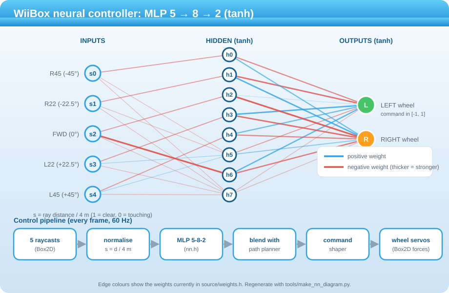

# WiiBox — Wii Robotics & Physics Sandbox

Bare-metal C++ homebrew: Box2D rigid-body arena, a differential-drive rover with 5 raycast
range sensors, and a header-only 5→8→2 MLP driving the wheels. Rendered with GRRLIB.

## Layout
```
WiiBox/
├─ Makefile
├─ source/
│  ├─ main.cpp      world, rover, sensors, planner, input, rendering, UI
│  ├─ nn.h          header-only MLP forward pass (no deps, no heap)
│  └─ weights.h     const weight arrays (hand-designed default; replaceable)
├─ tools/
│  ├─ train_export.py      scikit-learn trainer -> writes source/weights.h
│  └─ make_nn_diagram.py   draws docs/nn_diagram.svg from weights.h
├─ docs/nn_diagram.svg
└─ box2d/           git submodule (Box2D v2.4.1)
```

## How it works
<p align="center"></p>

Five raycast distances feed a 5→8→2 tanh network whose two outputs become the left and right wheel commands. Those commands are blended with the path planner when a goal is set, passed through a damping/smoothing shaper, and applied as wheel forces in Box2D. The diagram is generated from `source/weights.h` by `tools/make_nn_diagram.py`.

## Demo
<!-- Replace this line with your video: edit this file on github.com, drag demo.mp4 into the editor, and keep the URL it inserts. -->
*Demo video coming soon.*

## Build
1. Install devkitPro with `wii-dev`, then portlibs: `ppc-freetype ppc-libpng ppc-libjpeg-turbo ppc-bzip2 ppc-zlib`.
2. Build/install **GRRLIB** (https://github.com/GRRLIB/GRRLIB) so `grrlib.h` and `libgrrlib.a` land in `$DEVKITPRO/portlibs/wii` (use `sudo DEVKITPRO=/opt/devkitpro DEVKITPPC=/opt/devkitpro/devkitPPC make install` if you hit a permissions error). The Makefile also links `-lpngu` and the Brotli libraries (`ppc-brotli`) that newer FreeType needs.
3. Get **Box2D v2.4.1** (a git submodule, pinned to the right version):
   ```
   git clone --recursive https://github.com/kerolinux/WiiBox.git
   # already cloned without --recursive?  git submodule update --init
   ```
   The Makefile compiles it directly from `box2d/`.
4. `make` → `WiiBox.dol`. Copy to `sd:/apps/WiiBox/boot.dol` (or `make run` with wiiload).

If Box2D complains about a missing platform timer, `b2Timer` falls back to a stub on unknown
platforms; if your version doesn't, wrap its body in `#if 0` — the sandbox never uses it.

## Controls
| Input | Action |
|---|---|
| IR pointer | hand cursor; hover and press **A** on side-menu buttons |
| **A** (empty arena) | spawn a crate/ball and drag it |
| **A** (on a body) | grab and drag (rover included) |
| **B** + D-pad | manual drive override |
| Nunchuk stick | manual drive override |
| **1** / **2** | toggle sensor rays / pause |
| **−** / **+** | clear props / reset rover |
| **HOME** | exit to the Homebrew Channel |

Side-menu buttons: RESET, PAUSE, RAYS, CLEAR (props), BUILD, ERASE, MAZE, NO WALLS, GOAL, SEEK. Build mode, goals and mazes are described below.

## Design notes
- **Physics**: gravity-free top-down world, 60 Hz fixed step (8/3 iterations). Props use linear/angular damping as floor friction.
- **Drive model**: each wheel is a velocity servo applied *at the wheel contact point* (thrust + yaw torque) plus a lateral-slip impulse for side grip. Body has linear + angular damping. Tune in `namespace cfg`.
- **Sensors**: 5 `b2World::RayCast` queries, −45°…+45°, 4 m range, nose-mounted, self-hit filtered. NN input = `distance / range` (1 = clear). Ray colors: red < 25 %, orange < 50 %, yellow < 75 %, green otherwise.
- **Inference**: `nn::forward<5,8,2>` — tanh hidden, tanh output ∈ [−1,1] → left/right wheel speed command (× 3 m/s).
- **No allocations in the loop**: all bodies are pre-created; spawn = enable pooled body, clear = disable; dragging is velocity-based (no joints); HUD uses a built-in 3×5 bitmap font and a static `snprintf` buffer.
- **Walls**: the arena border is `kWalls[]` in `main.cpp` (`{cx, cy, halfW, halfH}` in metres, arena size in `cfg`). Everything inside is the paintable 0.5 m grid, including the two starter walls (`loadDefaultWalls()`).
- **Timing**: `GRRLIB_Render()` blocks on vsync, so NTSC/PAL60 run at a locked 60 FPS with a fixed 1/60 s step. On a 50 Hz PAL output the sim would run slow; use a 60 Hz video mode.

## Walls, mazes and stuck recovery
- **Build mode**: click **BUILD** (side menu). Hold **A** and drag to paint 0.5 m wall blocks; the first cell decides the stroke, so starting on an existing wall erases. Hold **B** or enable **ERASE** to erase. **NO WALLS** clears everything, including the two starter walls (restart the app to get them back).
- **MAZE**: generates a fresh random maze (1.5 m corridors, recursive backtracker), clears props and moves the rover to the start cell. **RESET** returns to the current start point and clears any walls painted over it.
- **Stuck recovery** (neural-net mode only): if the rover is being driven but has barely moved or turned for 0.75 s, it backs up while swinging away from the wall, then spins toward the clearer side and drives forward a short way to leave the spot. A separate 1.5 s check catches endless spinning in place. If it jams again within 3 s it tries the opposite side. The status pill shows BACKING UP while this runs.
- **Smooth steering**: all automatic commands pass through a shaper: yaw-rate damping (brakes the swing before it overshoots), a cap on turn strength, a speed limit when a wall is close ahead, and low-pass smoothing. The recovery turn is closed-loop too: it backs up briefly, then turns only until the front is open instead of for a fixed time.
- All 660 wall cells are static bodies created once at startup and enabled/disabled on demand, so building never allocates.

## Goal flag and navigation
- Click **GOAL**, then press **A** on the map to drop the flag on that cell (the mode ends after placing). With GOAL active, **B** removes the flag. **MAZE** places a flag in the far corner automatically.
- With a flag on the map and **SEEK ON**, the rover navigates to it. A breadth-first search over the wall grid (keeping one empty cell of clearance when possible) gives a downhill path; the rover steers toward a point 1.5 m along it. The neural net takes over local avoidance whenever something is close ahead, and stuck recovery stays active. **SEEK OFF** returns to the original wandering behaviour.
- Reaching the flag stops the rover and shows GOAL! with the time. The header shows goals reached and the run timer. Move the flag, press RESET, or generate a new maze to run again.

## Training your own weights
```
pip install numpy scikit-learn
python tools/train_export.py
```
The script behaviour-clones a reactive expert and regresses `atanh(target)` so the firmware's output `tanh` matches. For PyTorch, the export snippet at the bottom of the script gives the same `[H][IN]` / `[OUT][H]` layout. Keep sensor order and normalization identical to the firmware.

## Caveats
Written without access to a devkitPPC toolchain in this session, so it is **uncompiled**. Most likely friction points: GRRLIB link-library list for your GRRLIB version (edit `LIBS`), and Box2D include paths. Quick feature checks: `WPAD_SetVRes` uses 640×480 to match GRRLIB's default virtual screen.
